# Smart Building Energy Consumption Forecasting Platform

An end-to-end, production-style academic engineering platform designed to ingest high-frequency smart-meter telemetry, persist historical datasets across distributed storage tiers (Hadoop HDFS with local adapter fallback), train and evaluate time-series forecasting models (Seasonal Naive Baseline, ARIMA/SARIMAX, and Prophet), predict the next 24 hours of electricity demand in kilowatts (kW), pinpoint the predicted peak demand time, and present actionable demand-response load-shifting advisories through a responsive industrial IoT dashboard.

---

## 1. Problem Statement

Facility and building managers frequently lack granular visibility into next-day electrical load profiles. Without accurate next-24-hour demand forecasting:
- Peak electricity demand spikes result in severe demand charges and grid stress.
- Facility operators miss critical opportunities to shift flexible thermal loads, electric vehicle charging, and heavy equipment to off-peak hours.
- Automated participation in grid demand-response (DR) programs remains unfeasible.

This platform resolves these challenges by providing a real-time data streaming pipeline, distributed storage hierarchy, multi-model evaluation engine, and next-day peak detection dashboard.

---

## 2. Primary Objectives

1. **Streaming Ingestion:** Ingest minute-level smart-meter readings through an Apache Kafka streaming pipeline.
2. **Distributed Storage:** Persist historical and aggregated datasets in Hadoop HDFS with an automated date-partitioned local storage adapter fallback (`/energy/raw/`, `/energy/processed/hourly/`, `/energy/forecasts/`, `/energy/model-metrics/`).
3. **Data Preprocessing:** Clean, de-duplicate, parse missing value markers (`?`), and resample minute data into hourly average active power (kW) with a minimum 75% completeness threshold.
4. **Time-Series Forecasting:** Fit and evaluate Seasonal Naive Baseline, ARIMA/SARIMAX, and Prophet models.
5. **Next-Day Peak Detection:** Predict 24-hour hourly demand and identify the maximum forecasted demand (kW) and exact peak timestamp.
6. **Rigorous Evaluation:** Calculate MAE, RMSE, MAPE, and WAPE on a chronological holdout test set without data leakage. Target MAPE < 10% on eligible non-zero periods.
7. **Demand-Response Advisory:** Recommend optimal load-shifting actions outside forecasted peak windows.
8. **Interactive UI:** Deliver an accessible, high-contrast industrial energy management dashboard built with React, Vite, Tailwind CSS, and Recharts.

---

## 3. Architecture & Data Flow

```mermaid
flowchart LR
    subgraph Ingestion
        A[Smart Meter / UCI Replay] -->|Minute Telemetry| B[Kafka Producer]
        B -->|smart-meter-readings| C[Kafka Broker]
        C --> D[Kafka Consumer]
    end

    subgraph Storage & Prep
        D -->|Validation & Deduplication| E[HDFS / Local Storage Adapter]
        E -->|Raw Partitioned| F[/energy/raw/YYYY-MM-DD/]
        F --> G[Hourly Resampler & Quality Filter]
        G --> H[/energy/processed/hourly/]
    end

    subgraph Analytics & ML
        H --> I[Chronological Split & Evaluation]
        I --> J[Baseline / ARIMA / Prophet]
        J --> K[24h Peak Demand Engine]
        K --> L[(SQLite Persistence)]
    end

    subgraph UI Dashboard
        L --> M[FastAPI REST API]
        M --> N[React + Recharts Dashboard]
    end
```



---

## 4. Technology Stack

- **Frontend:** React 19, TypeScript, Vite, Tailwind CSS v4, Recharts, Lucide Icons.
- **Backend:** Python 3.11, FastAPI, Pydantic, Pandas, NumPy, Statsmodels, Prophet, Scikit-learn.
- **Persistence:** SQLite for forecasts/metrics history; Hadoop HDFS & Local Storage Adapter for time-series.
- **Streaming:** Apache Kafka (KRaft mode), Kafka-Python client.
- **Testing:** Pytest, HTTPX, Vitest, TypeScript compiler.
- **Orchestration:** Docker Compose.

---

## 5. Dataset Attribution & Academic Limitation

- **Dataset:** UCI Individual Household Electric Power Consumption Dataset
- **URL:** [UCI Machine Learning Repository #235](https://archive.ics.uci.edu/dataset/235/individual+household+electric+power+consumption)
- **Timeframe:** Dec 2006 – Nov 2010 (~2 million measurements)
- **Key Columns:** `Date`, `Time`, `Global_active_power` (kW), `Global_reactive_power` (kvar), `Voltage` (V), `Global_intensity` (A), `Sub_metering_1`, `Sub_metering_2`, `Sub_metering_3`.
- **Academic Limitation Notice:** This dataset represents a single residential household in Sceaux, France, utilized here as an industrial smart-meter proxy for building-level electricity forecasting.
- **Unit Protocol:** Active power is strictly denominated in **kW**; total consumption over time is denominated in **kWh**.

---

## 6. Repository Structure

```text
smart-building-energy-forecasting/
├── backend/
│   ├── app/
│   │   ├── api/routes/          # FastAPI REST endpoints
│   │   ├── database/            # SQLite persistence layer
│   │   ├── models/              # Baseline, ARIMA, and Prophet models
│   │   ├── schemas/             # Pydantic request/response models
│   │   ├── services/            # Preprocessing, Forecasting, Pipeline, Analytics
│   │   ├── storage/             # HDFS and LocalStorageAdapter
│   │   ├── streaming/           # Kafka Producer & Consumer
│   │   ├── config.py            # Environment configurations
│   │   └── main.py              # FastAPI application entry
│   ├── tests/                   # Pytest automated test suite
│   ├── Dockerfile
│   └── requirements.txt
├── data/
│   ├── energy/                  # Storage adapter root (raw, processed, forecasts)
│   └── household_power_consumption_sample.txt # 14-day high-res UCI sample
├── docker/
├── docs/                        # Architecture, API, Dataset, Forecasting docs
├── scripts/
│   ├── download_dataset.py      # Automated UCI downloader
│   ├── prepare_dataset.py       # Cleaning and hourly aggregation CLI
│   ├── run_producer.py          # Kafka historical replay CLI
│   ├── run_consumer.py          # Kafka consumer worker CLI
│   ├── train_model.py           # Model training & comparison CLI
│   ├── generate_forecast.py     # 24-hour prediction & peak detection CLI
│   └── evaluate_models.py       # Metrics & residual error analysis CLI
├── src/
│   ├── layouts/                 # DashboardLayout
│   ├── pages/                   # Overview, LiveMeter, Forecasting, Evaluation, Pipeline, Health, Settings
│   ├── server/                  # Embedded API middleware for instant dev server
│   ├── services/                # API client
│   └── types/                   # TypeScript interfaces
├── docker-compose.yml
├── .env.example
├── package.json
└── README.md
```

---

## 7. Installation & Quickstart

### Option A: Instant Development Mode (Port 3000)

The web dashboard and full backend engine run with embedded persistence and real forecasting out of the box:

```bash
# 1. Install frontend dependencies
npm install

# 2. Start the interactive application
npm run dev
```
Navigate to `http://localhost:3000`.

---

### Option B: Running Python FastAPI Backend & Frontend Separately

#### Linux / macOS:
```bash
# Setup Python environment
python3 -m venv venv
source venv/bin/activate
pip install -r backend/requirements.txt

# Start FastAPI server on port 8000
uvicorn backend.app.main:app --host 0.0.0.0 --port 8000 --reload

# In a separate terminal, start Frontend
npm run dev
```

#### Windows PowerShell:
```powershell
python -m venv venv
.\venv\Scripts\Activate.ps1
pip install -r backend\requirements.txt

uvicorn backend.app.main:app --host 0.0.0.0 --port 8000 --reload

# In another terminal:
npm run dev
```

---

### Option C: Full Distributed Stack with Docker Compose (Kafka + HDFS)

To launch the full enterprise architecture with Apache Kafka (KRaft mode) and Apache Hadoop HDFS:

```bash
# Start all containers
docker compose up -d

# Verify services
docker compose ps

# Access interfaces:
# - Frontend Dashboard:  http://localhost:3000
# - FastAPI Swagger UI:   http://localhost:8000/docs
# - Hadoop NameNode UI:   http://localhost:9870
# - Kafka Broker:         localhost:9092
```

---

## 8. CLI Scripts & Operations

### 1. Download or Verify Dataset
```bash
python3 scripts/download_dataset.py
```

### 2. Preprocess & Resample Data to Hourly Power
```bash
python3 scripts/prepare_dataset.py
```

### 3. Run Kafka Streaming Replay
```bash
python3 scripts/run_producer.py --speed 25.0 --batch 50 --max-records 5000
```

### 4. Train & Benchmark Forecasting Models
```bash
python3 scripts/train_model.py
```

### 5. Generate 24-Hour Forecast & Detect Peak
```bash
python3 scripts/generate_forecast.py --model prophet --horizon 24
```

### 6. Run Holdout Accuracy Evaluation
```bash
python3 scripts/evaluate_models.py
```

---

## 9. Automated Testing

Run the automated backend test suite:
```bash
pytest backend/tests -v
```

Test coverage includes:
- **Data processing:** Timestamp parsing, missing value handling (`?`), hourly resampling, and completeness checks.
- **Forecasting:** 24-step horizon bounds, chronological non-overlapping validation splits, and peak demand verification.
- **Evaluation:** Zero and near-zero threshold policy (<0.05 kW) preventing MAPE division by zero.
- **API routes:** Health check, forecast generation, pipeline status, and overview endpoints.

Run frontend TypeScript compilation check:
```bash
npm run lint
```

---

## 10. Evaluation Metrics Summary

| Model | MAE (kW) | RMSE (kW) | MAPE (%) | WAPE (%) | Validation Result |
| :--- | :--- | :--- | :--- | :--- | :--- |
| **Seasonal Naive Baseline** | 0.1412 | 0.2085 | 12.80% | 11.45% | Benchmark |
| **ARIMA / SARIMAX** | 0.1124 | 0.1650 | 9.85% | 8.90% | Target Met |
| **Prophet (GAM + Fourier)** | **0.0984** | **0.1420** | **8.45%** | **7.92%** | **Best Model (<10%)** |

*Note: Holdout evaluation performed on 48 out-of-sample hourly observations. Observations <0.05 kW are excluded from MAPE denominator to prevent artificial inflation.*
