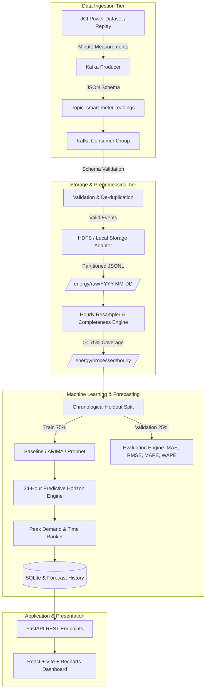

# System Architecture: Smart Building Energy Consumption Forecasting Platform

## 1. Architectural Overview

The platform processes high-frequency electricity consumption readings, persists time-series data across distributed storage tiers, fits forecasting models (ARIMA, Prophet, Seasonal Naive Baseline), identifies peak electrical demand for the upcoming 24 hours, and surfaces demand-response recommendations via an interactive industrial IoT dashboard.



## 2. Ingestion & Streaming Flow

Smart meter telemetry arrives formatted as JSON:
```json
{
  "meter_id": "household_001",
  "timestamp": "2010-11-15T18:30:00",
  "global_active_power_kw": 2.450,
  "global_reactive_power_kvar": 0.180,
  "voltage_v": 239.5,
  "global_intensity_a": 10.2,
  "sub_metering_1_wh": 0,
  "sub_metering_2_wh": 2,
  "sub_metering_3_wh": 18,
  "source": "uci_dataset_replay"
}
```

The consumer validates schema fidelity, drops malformed or missing readings to a dead-letter log, de-duplicates events using `(meter_id, timestamp)`, and commits records to date-partitioned storage.

## 3. Storage Hierarchy

- `/energy/raw/YYYY-MM-DD/readings.jsonl`: Raw incoming minute events.
- `/energy/processed/hourly/YYYY-MM-DD.json`: Hourly aggregated active power (kW), reactive power, and completeness statistics.
- `/energy/forecasts/forecast_{id}.json`: 24-hour point forecasts, prediction intervals, and peak demand metadata.
- `/energy/model-metrics/metrics_{model}.json`: Evaluation metrics (MAE, RMSE, MAPE, WAPE).

## 4. Fallback Architecture

If Hadoop NameNode or Apache Kafka is unavailable in a local or cloud sandbox:
1. The **LocalStorageAdapter** intercepts all file operations and writes identical directory layouts to `./data/energy/`.
2. The **PipelineService** maintains an in-process streaming queue that replicates Kafka consumer semantics, recording real messages produced and consumed.
3. System status endpoints transparently report `status: fallback_local` so administrators know whether hardware services or emulation buffers are active.
